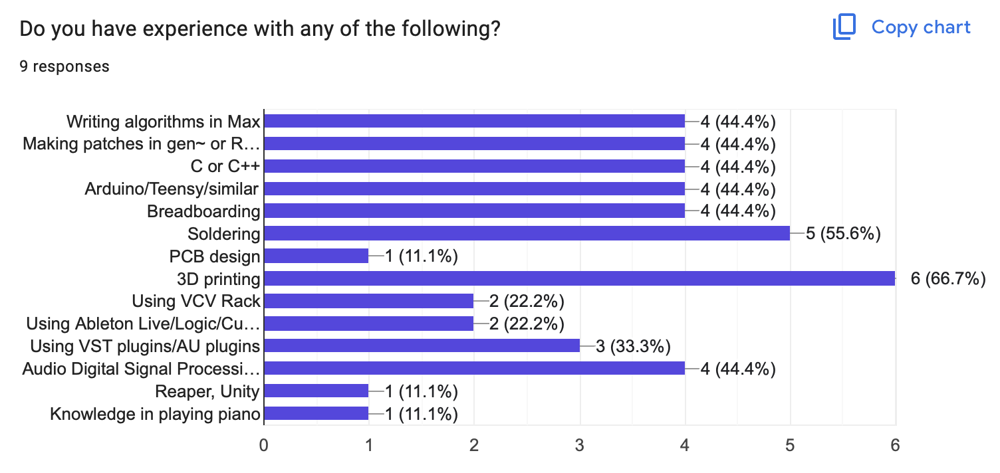
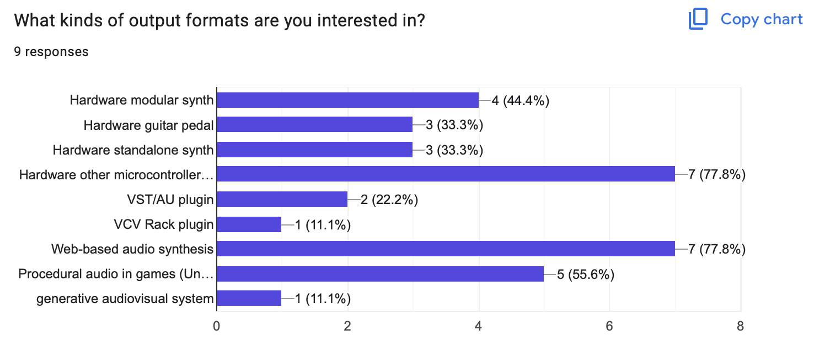

# DATT4074 | DIGM6074 Synthesis Workshop

## Course Information

Wednesdays, 9.30am-12.20pm, [Fine Arts building room ACW 103](https://find.yorku.dev)

This includes both 
- *DATT4074 Creative Audio Signal Processing II: **Synthesis Workshop*** and 
- *DIGM 6074 Generative Sound & **Synthesis Workshop***

**Instructor:** [Graham Wakefield](https://discover.academics.yorku.ca/Graham.Wakefield) g rrr w aaa a t yo rk u do t ca

> For those that don’t know me, I’m a researcher and Associate Professor in Digital Media, but I’m also deeply involved in the audio software/hardware industry as a developer for audio software [(Max/MSP's gen~)](https://cycling74.com), a developer of software for dedicated audio hardware platform ([Electrosmith Daisy](https://daisy.audio/)), and for professional audio hardware products (recently launched: [Fancyyyyy K-Accumulator](https://www.fancysynthesis.net/)), all experience I’ll be bringing to the course.  

Office hours: Thursdays, 9:30am-11:30am, in the Alice Lab - GCFA 309

**Course material** is available at or linked from [this website](https://alicelab.world/DATT4074) -- bookmark it! 

**Assignments** will be handled through **e-Class** 
- Undergraduate at [https://eclass.yorku.ca/course/view.php?id=157128]()
- Graduate at [https://eclass.yorku.ca/course/view.php?id=157121]() 

**Class recordings**: I often share screen and record classes via Zoom. This doesn't mean the class is hybrid (in-person attendence is required and will be accounted), but I have heard that it has been useful for many students to be able to review sessions after class hours, or to view a live class on their personal laptop screens. 
- [Zoom meeting (same link every week)](https://yorku.zoom.us/j/93856257447?pwd=38tAeaKReiULvX3vOMVORoW3bJQIOD.1)
- [Add it to your calendar (.ics file)](https://yorku.zoom.us/meeting/tJclcu-qqzwuHtNdaKtRMtSDvpFNb2HzWijE/ics?icsToken=DMk7sXsoFa5zP12M-wAALAAAAC43fiWPlGSR19UxF5GYW3-hcardNuY7NAbGrZ8lfnYJfI2wirC49UGypNfWFQRmIVjTO1WYC3GtucAeFzAwMDAwMg&meetingMasterEventId=KANIVnCvTtKGmxXoAb5smg)
- [List of class recordings](#class-recordings)

---

This is a problem-driven and technique-focused studio course — part hackathon, part production incubator — where you take a sample-level interactive audio synthesis idea from prototypes to finished, portfolio-ready products in software and/or hardware.

You can work solo or in groups, and develop final projects in a variety of possible forms:

🎛️ Hardware — Design your own device: a standalone instrument, a guitar pedal, a modular synthesos module, or an interactive art installation. In the course of this, get to know analog hardware and build embedded digital audio systems!  

🎮 Game Audio — Build adaptive sound and procedural foley systems that react live inside game engines such as Unity and Unreal. 

🔌 Plugins — Build real plugins that work with the audio software or video editors people already use such as Ableton Live or VCV Rack. 

🌐 Web & XR — Create generative audio for browser-based experiences, games and WebXR worlds. 

Instruction includes a blend of essential topic instruction with online resources, but mainly focuses on per-project supervision. 

Your progress is documented in a continuous development log, and final creative projects that can form part of a graduating portfolio. 

### Course software

We will work with the same tools many professional studios and hardware companies use to prototype sonic algorithms in the real world. To begin developing synthesis algorithms we will work using the **gen~** environment within [Cycling '74's Max](https://cycling74.com). 

> All students have access to a license for Max supported by the course fees. License codes should be coming to all students through the department after our first attendance check. The computers in ACW 102 also have Max installed and licensed, and students can come in to use them during open lab hours. Two of the machines in DM labs also have the RNBO license that you may need for the final project. 

### Evaluation

- **25% Dev Log**   
An online log of project design and the development progress, maintained throughout the course. 
  - It should be hosted on your project's Github, either via a wiki or as a webpage via the `gh-pages` branch. 
  - It should be updated with **weekly entries** that include a) your progress, b) insights, c) next steps and d) any current roadblocks. 

- **25% Presentation & Discussion**   
Presenting work-in-progress to the group, and generous contribution to discussion. 
  - First presentation: Inspirations & Ideas
  - Second presentation: Progress update with prototype demonstration
  - Final presentation: Final project & demonstration
  - If necessary, presentations can be submitted as prerecorded videos. 

- **25% Final distributable project**   
A functional, professional embodiment of the sonic ideas in a specific application format such as: adaptive sound generators for video games; new embedded hardware for guitar pedals, modular synthesizers, or interactive art installations; embedding in web-native projects; creating plugins for desktop software.

- **10% Attendance (Undergraduate only)**

- **15% Website (Undergraduate only)**   
Documentation of the final project in the form of a web page with embedded video demonstration.

- **25% Research paper (Graduate only)**   
The final project implementation documented in research-appropriate writing, such as an academic paper suitable for submission to a conference such as NIME (New Instruments for Musical Expression), SMC (Sound Music Computing), or another comparable research document. 

### Related Courses

The course accompanies [DATT3074](https://alicelab.world/datt3074/) **Creative Generative Audio Signal Processing**, which focuses on sample-level audio synthesis algorithms. 

The course complements and supports Sonic Arts stream courses in Digital Media, including DATT4071/DIGM5071/6071 and DATT3070/4070/DIGM5070. The course may also directly contribute to project development in other courses such as DATT4700, DATT4520, and EECS4441.

[Back to top](#top)

# Week 1: Introduction
Sep 9 - [Class Recording](#class-recordings)

**Hello and welcome!**

Introduction to the course

*It's the 1st time to run this course, so the roadmap will be fleshed out more after I know more about what your interest foci are (after the 1st week's homework).*

Context: over a century of electronic sound synthesis & instrument design, intertwining creativity & technology 
  - Explore https://nodemusic.cc/horizon (Katerina Ryzhzh, 2026) + discussion
  - Mechanical, Analog, Digital, AI? 
  - Interconnectivity: Voltage, MIDI, plugins, networking, ...?
  - Mimicry, supernormal, alien
  - Physicality
  - Why is modular resurgent?
  - What's missing from this graph?

Presentation:

https://docs.google.com/presentation/d/147RoDVI9CexC3cXXdqOqc6ns1jGn0L_rGpgzSky1RvA/

- [Survey](https://docs.google.com/forms/d/e/1FAIpQLSfc-nzHniN77CjY7-6F_ik-i8j4uW_9yHiZzF3MV-fmJt_4pQ/viewform?usp=publish-editor)
- Attendance
- Max license question

- Open-ended demonstration: Modular, gen~, Oopsy & different Daisies :-)

## Homework week 1

Do some field research into reference videos about audio synthesis projects while thinking about what you would like to build. Collect the best 3 reference projects to your interest.

- They could be guitar pedals, modular synthesis modules, DIY instruments, VST plugins, sonic art installations, game audio, etc.  Keep their scope fairly narrow though -- modular modules, pedals and plugins are good choices because usually each one focuses on a single synthesis algorithm.
- All 3 should be different enough from each other so that they cover the different aspects of what you might want to do. For example:
  - One could be selected for what makes it interesting in terms of audio synthesis or generative algorithms
  - One could be selected for the interestingness of its interface 
  - At least one should be a project that explains how it was made (e.g. DIY, open source, tutorial video, etc.). Its OK if you don't fully understand it yet, or if it looks beyond what you think you can achieve. 

[Add these videos to slides in this presentation](https://docs.google.com/presentation/d/1xG5xHPcHTgD2Z7tH2E1d0mNjhQ2WEzrlkpEth35PLUI/edit?usp=sharing)

*Be careful not to accidentally overwrite one of your colleagues slides!*

For each one, think about how to answer these questions:
  - What is especially impressive or inspiring to you about it?  What makes it uniquely interesting? 
  - What surprised you in the details or implementation / what did you learn from it that you intend to apply?
  - Where do you think the project is weak, why, and how could it be better?

Put these answers into the slides (or presenter notes)

Can you sketch out what a hybrid between 2 or 3 of your references might look like?


**Also for next week: remember to bring headphones and/or portable speakers -- we will start flashing Daisies together**

# Week 2: Inspirations & Flashing Daisy

[Zoom meeting (same link every week)](https://yorku.zoom.us/j/93856257447?pwd=38tAeaKReiULvX3vOMVORoW3bJQIOD.1)

## Inspiration slides

Inspiration slides:

https://docs.google.com/presentation/d/1xG5xHPcHTgD2Z7tH2E1d0mNjhQ2WEzrlkpEth35PLUI/

[Attendance](https://eclass.yorku.ca/mod/attendance/manage.php?id=4452130)


## Daisy setup

[Setting up the Daisy toolchain & Flashing Daisy on breadboards from Max](daisy.html)

## Homework Week 2

Let's use Github to manage our projects and collaborations.  Git is not *ideal* for working with Max files, but there really isn't a better option.

- Set up a personal [github account](https://github.com/signup) if you don't already have one.
- As a group: 
  - Either have one of you create a repository for the project and all all other group members as collaborators (admin level), or
  - Create an "organization" for your group, have all members join, and create a repository for the project
- Whichever you choose, also invite the professor (username `grrrwaaa` to your project)
- Also add a `gh-pages` branch to the repository to make a webpage for it

If you have never used `git` before, you'll need to get to know it. We don't need to get super deep, but understanding the basic idea of version control, history, repositories, commits, status/pull/push, branches and merges should be enough. 
- here's what Github recommends: https://docs.github.com/en/get-started/start-your-journey/git-and-github-learning-resources 
- here's a decent tutorial: https://www.youtube.com/watch?v=8JJ101D3knE

# Week 3: Inspirations & Flashing Daisy II

[Zoom meeting (same link every week)](https://yorku.zoom.us/j/93856257447?pwd=38tAeaKReiULvX3vOMVORoW3bJQIOD.1)

Github project setup checkin!

## Survey results:



Most respondents do not own or plan to bring their own equipment or hardware to class, though a few have Arduino, ESP32, sensors, servos, and other electronic components.



(What that doesn't show, but I think is interesting, is that 8/10 of you said *some kind of hardware*, and almost all of you picked at least one *software based output*, mostly web and game engine.)

Synthesis algorithms: 

- General Interest and Exploration: Several respondents are unsure of specific algorithms yet, but are interested in learning **new techniques**, expanding their repertoire, and exploring general concepts.
- Effects and Sound Manipulation: Specific technical interests include **echo, reverb, delay** effects, **live audio degradation** such as **bitcrush and bitrate loss**, **feedback loops**, and **signal mashing**.
- Generative and Interactive Sound: Interest exists in **generative sound, algorithmic synthesis**, and **parameter mapping driven by interaction or simulation data**.
- Thematic and Applied Audio: Specific applications mentioned include **video game sound effects**, **8-bit** Pokémon-style sound synthesis, **visual audio**, **glitch** styles, and technology-based music including siren sounds.

Thank you, I will focus material on both hardware (gen~/Daisy based) and software (primarily web-based, but also game engine, both via gen~/RNBO). I will address many of the signal processing techniques here, especially delay-based effects and feedback, and lo-fi emulation/glitch, both of which mesh very nicely with generative sound and algorithmic synthesis. 

## Inspiration slides part II

Inspiration slides:

https://docs.google.com/presentation/d/1xG5xHPcHTgD2Z7tH2E1d0mNjhQ2WEzrlkpEth35PLUI/

Discussion.

[Attendance](https://eclass.yorku.ca/mod/attendance/manage.php?id=4452130)

## Daisy setup part II

Adding more breadboard components and configuring a custom JSON file.

I have 5 kits ready to go for group work. 

[Setting up the Daisy toolchain & Flashing Daisy on breadboards from Max](daisy.html)

Today's patch: https://raw.githubusercontent.com/worldmaking/DATT4074/refs/heads/main/week3/week3.maxpat

And the json "mytarget.json":

```json
{
    "som": "seed",
    "components": {
        "knob1": {
            "component": "AnalogControl",
            "pin": 25
        }
    }
}
```

<!--
## Homework

Finalize your working groups. Set up github (last week's homework) if you haven't yet. 
-->

---

# Week 4: Modular Synthesis

[Zoom meeting (same link every week)](https://yorku.zoom.us/j/93856257447?pwd=38tAeaKReiULvX3vOMVORoW3bJQIOD.1)

A quick reminder of the course goal (*"where you take a sample-level interactive audio synthesis idea from prototypes to finished, portfolio-ready products in software and/or hardware"*):
- This course is about building YOUR professional portfolio projects, exploring a uniquely interesting implementation of audio synthesis in software and hardware.  
- My role will be to support you through the semester, with some direct presentations & training but mostly focused guidance at the individual/group level. 

Where we are at in terms of [evaluation](#evaluation):
- **Dev Log** (25%): This will be hosted on your Github, either as a wiki page or as a github pages (`gh-pages` branch) page. From this week onward, it should be updated with **weekly entries** that include your progress, insights, next steps and any current roadblocks. If you haven't set up your Github yet, please complete that today. See the instructions [here](#homework-week-2). Let me know the link here:
  - Undergraduate: https://eclass.yorku.ca/mod/assign/view.php?id=4495614
  - Graduate: https://eclass.yorku.ca/mod/assign/view.php?id=4495615
- **Presentations & Discussion** (25%): Most of you have now presented your inspirations & proposals, but not all. If you haven't done this yet, please submit it to me as video. 
  - Undergraduate: https://eclass.yorku.ca/mod/assign/view.php?id=4495539
  - Graduate: https://eclass.yorku.ca/mod/assign/view.php?id=4495542
  - There will be two more presentations in the course -- one mid-term progress report & prototype demonstration, and one final project presentation. 
  - Most of you also filled in the [Initial Survey](https://docs.google.com/forms/d/e/1FAIpQLSfc-nzHniN77CjY7-6F_ik-i8j4uW_9yHiZzF3MV-fmJt_4pQ/viewform) -- if you haven't done this yet please do, it's part of this grade section. 

## Student Project Table

It is time to commit to your project details. I've created a shared group Google Sheets document to keep track of projects. Please update your entry in this table!
- The most urgent items for this table are your Github project address, your platform target(s), and specific hardware requirements or any other urgent questions/roadblocks to resolve. 
- If you still don't know what your project is going to be, I can assign you to developing a modular synthesis module, which exists both as a virtual device for VCVRack, as well as a physical device, using one of the Daisy-powered devices in the Alice Lab rack. 

[https://docs.google.com/spreadsheets/d/15kdXMd4mkTN9xu2M9P1Lw8GIWAWJFR1Anq_oSGN6aug/](https://docs.google.com/spreadsheets/d/15kdXMd4mkTN9xu2M9P1Lw8GIWAWJFR1Anq_oSGN6aug)

## Discord

Since I can't merge the eClass courses, we can't run discussion through that. I know that Discord is a popular option in many DM courses, so I've set one up for our class.  I can create groups/channels for project groups if you want.  

Here's the invitation link: https://discord.gg/NgWzWRbhJ

---

[Attendance (undergraduate only)](https://eclass.yorku.ca/mod/attendance/manage.php?id=4452130)

## Modular Synthesis

[Modular Synthesis](modular.html)

## Breadboarding Daisy III

[Continuing the breadboarding with Daisy -- buttons, LEDs, and other components](daisy.html)

Today's patch: https://raw.githubusercontent.com/worldmaking/DATT4074/refs/heads/main/week4/week4.maxpat

Today's JSON:

```json
{
	"som": "seed",
	"components": {
		"knob1": {
			"component": "AnalogControl",
			"pin": 20
		},
		"switch1": {
			"component": "Switch",
			"pin": 26,
			"pull": "daisy::Switch::PULL_DOWN",
			"polarity": "daisy::Switch::POLARITY_NORMAL"
		},
		"switch2": {
			"component": "Switch",
			"pin": 27
		},
		"led1": {
			"component": "Led",
			"pin": 3,
			"invert": false
		}
	}
}
```

# Week 5

[Zoom meeting (same link every week)](https://yorku.zoom.us/j/93856257447?pwd=38tAeaKReiULvX3vOMVORoW3bJQIOD.1)

One-on-one support & discussion with each student/team.

[Attendance](https://eclass.yorku.ca/mod/attendance/manage.php?id=4452130)

---

## Project Teams

| Team/Project Name | Names | Dev Log / Github |
|:--- |:--- |:--- |
| SoundChefs Bar Simulator | Kaitlyn + Emma | [Dev Log](https://docs.google.com/document/d/18WgLjXUiOX2booo8zJPbjUysZJ3e3CS26g92JNSm5DY/edit?tab=t.0#heading=h.os2bgtt5lvmz), [Github](https://github.com/kaitavly/daisy-workshop-.git) |
| D.E.A.N | Marce + Adrien | [Dev Log](https://github.com/machinepirate/DEAN/blob/main/DevLog.md), [Github](https://github.com/machinepirate/DEAN) |
| Dependent Machinery | Fran | [Dev Log](https://github.com/anglerfishing-io/DIGM-6074-Carandang-Project-01/wiki), [Github](https://github.com/anglerfishing-io/DIGM-6074-Carandang-Project-01) |
| La résonance | Winnie | [Dev Log](https://weeenluo-0907.github.io/DIGM6074-Synthesis-Workshop-W/), [Github](https://weeenluo-0907.github.io/DIGM6074-Synthesis-Workshop-W/) |
| Tap the World / Object2Sound | Jingwen | [Dev Log](https://github.com/qOp3/DATT6047Object2Sound/blob/main/Dev%20log.md), [Github](https://github.com/qOp3/DATT6047Object2Sound) |
| Regular Degrader | Autumn + Cristian | [Dev Log](https://github.com/spangyc/Regular-Degredar---DATT4074-Project-/blob/main/Devlog.md), [Github](https://github.com/spangyc/Regular-Degredar---DATT4074-Project-) |
|  | Nicole | [Dev Log](https://ndjia.github.io/datt4074/), [Github](https://github.com/NDJia/datt4074) |
| Noise Looper | John | [Dev Log](https://docs.google.com/document/d/18WgLjXUiOX2booo8zJPbjUysZJ3e3CS26g92JNSm5DY/edit?tab=t.0#heading=h.os2bgtt5lvmz), [Github](https://github.com/gzapper/GS-DIGM-6074-project-gzapper) |

# Reading Week

# Week 6

One-on-one support & discussion with each student/team.

[Attendance](https://eclass.yorku.ca/mod/attendance/manage.php?id=4452130)

# Week 7

One-on-one support & discussion with each student/team.

---

Many of you are making great progress, but it seems that not everyone has the Dev Log set up.  This should have been set up several weeks ago.  Please add the link to your dev log to the shared document at https://docs.google.com/spreadsheets/d/15kdXMd4mkTN9xu2M9P1Lw8GIWAWJFR1Anq_oSGN6aug.  At the very minimum, this can be a Markdown file in your github.  There should be update entries every week, this is how I can keep track of where your progress is going and what roadblocks you may have. 

From next week -- mid-project presentations. Please include a couple of slides and also a demonstration of your work in progress. It doesn't have to be onerous: Just a progress update with prototype demonstration, around 10 minutes maximum. Focus on: what you have achieved so far (demonstrate as much as you can), what insights or observations you have made so far, and what are the remaining steps to complete the project, including any questions and roadblocks.  

[Attendance](https://eclass.yorku.ca/mod/attendance/manage.php?id=4452130)

# Week 8

[Zoom meeting (same link every week)](https://yorku.zoom.us/j/93856257447?pwd=38tAeaKReiULvX3vOMVORoW3bJQIOD.1)

## Mid-Project Presentations (1st group)

[Attendance](https://eclass.yorku.ca/mod/attendance/manage.php?id=4452130)

# Week 9

[Zoom meeting (same link every week)](https://yorku.zoom.us/j/93856257447?pwd=38tAeaKReiULvX3vOMVORoW3bJQIOD.1)

## Mid-Project Presentations (2nd group)

[Attendance](https://eclass.yorku.ca/mod/attendance/manage.php?id=4452130)


## Recommendations/Requirements for Website Documentation (undergraduate students)

**Don't leave this to the last minute -- get a draft going and hosted online ASAP and verify that you know how to include images, video, and sound examples as necessary.**

Think of it as a portfolio piece and a reproducible technical record, not a lab report.  The site should let someone who has never met you understand 
- what you built
- why you built it
- how it works 

### Website Content 

The grading rubic for this assignment is based on the list below (not necessarily in this order). The list looks long, but much of this material you may already have drafted through the presentations and dev logs.  

- Basic essentials:
  - Project/product title
  - Team name if you have one
  - Your actual names, 
  - Course (DATT4074, Digital Media, York University, Fall 2026)
- "Hero" main image 
- Project Description
  - What the instrument/system does and how someone interacts with it
  - Your motivation and artistic/musical intent
  - Include 2-4 references of related or inspirational work, and how your work relates to or departs from them. 
  - Include links wherever possible for any citations/references/related work
  - Intended audience or performance/use context
- If it is software like a VST or VCV plugin, how they can install it; otherwise a link to the github and description of dependencies
- A demonstration video (1-3 minutes). 
  - You'll probably need to use Youtube or similar, as github pages is not appropriate to host large video files. Ensure the video is publicly visible. 
  - Show the project in actual use
  - Record the project's audio output with high quality (direct from the device, not phone microphone)
    - If this is not possible for whatever reason, add some direct recorded audio clip examples to the website
  - For hardware: show close-up shots as well as wider shots that include visible gestures/interaction
  - For software: show details as well as the use in wider context (e.g. within a DAW or other host environment)
- System Design & Implementation
  - A description of the principal inputs, processes and outputs.  A visual block diagram is ideal. 
  - A description of interaction design: what gestures or inputs or interface elements map to what sound parameters, and why. Explanation of your mapping strategy. 
  - 2-4 Focused screenshots on the most essential/interesting parts of the Max / gen~ patch or code. Under each image, explain what was interesting, innovative, essential or different about them. 
  - For hardware: list all the hardware components ("Bill of Materials"), include photographs of the build internally and externally, and include notes on any construction/fabrication involved
- Iterative refinement
  - Document at least two meaningful steps in the iterative design & implementation.  
  - What worked, what didn't, what you would change / Known issues, challenges encountered, troubleshooting steps, lessons learned. 
  - A few ideas about how you could continue or extend the project in the future
- Credits/acknowledgements
  - For teams: clearly identify individual contributions
  - Attribution for all borrowed code, libraries, samples, images, tutorials, ideas.  
  - A clear statement about your license for the code/patches (required for Github anyway) and creative work (e.g. choose a [Creative Commons](https://creativecommons.org) license)
  - Disclosure of any use of gen AI tools (and how/where this helped or did not help)
  - Include links wherever possible for any citations/references/related work
- Extra credit:
  - Some statistical measures of performance, e.g. CPU load (include CPU properties), latency, stability over long periods, etc.
  - A recorded musical/artistic performance using it

### Writing tips

- Imagine the reader is a smart student or professional, but who hasn't taken a class like this. 
- Show then tell: start each section with an image/diagram/video and then follow with text. 
- Be specific: "a 100k potentiometer is mapped to filter cutoff with an exponential curve" is much better than "a sensor controls the filter"
- Be honest about failures -- dead ends are valuable lessons learned and will be credited, not penalized!
- Prioritize clarity over decoration. 

### How to host the website

You can host the website on Github Pages alongside your Github project.  To do this, create a branch called `gh-pages` (the name has to be exact). 

1. Go to your repository on GitHub.
2. Click the branch dropdown menu on the top-left (it usually says main or master).
3. Type `gh-pages` into the text box.
4. Click Create branch: gh-pages from 'main'.

- The `gh-pages` is a special branch of your github repository that can host HTML pages on the web. If you push a file called `index.html` to this `gh-pages` branch, it will be visible online as a webpage at https://[your github name].github.io/[your project name]. If your github name is "foo" and the project is "bar", the URL will be https://foo.github.io/bar
- Remember that updates pushed to a website may not be visible immediately, it can take a few minutes for updates to propagate and be visible on the web. 
- My recommendation is to keep it as simple as possble: a static site written in plain HTML/CSS. There are many example minimal static html/css bootstrap templates online you can start from. You are not being evaluated on website development, but on the content. 
- It's up to you whether you make this a single-page website (easiest) or split the material into multiple pages.  You might want to make a home page that has public-facing material more similar to a product page or artist page, and a secondary page that includes the more academic requirements; that's up to you. 
- [See the Github documentation here](https://docs.github.com/en/pages/getting-started-with-github-pages/creating-a-github-pages-site), or follow one of the many tutorials online.      
- Remember to test your website both on a computer with a reliable browser (Firefox or Chrome) as well as on a phone. 
- Remember to keep images at a reasonably low resolution, no more than 1-2mb each. Include alt-text and/or captions for all images for accessibility and readability. 
- Test all links on the site to ensure they work. 


### Examples

It's the first time to run this course so we don't have previous years' student projects to share. Instead, here are some example final project websites from other similar courses around the world. These don't completely match the recommendations above, but they have many similarities:

- https://wp.nyu.edu/nyushanghai-kenwu/category/nime/
- https://fabacademy.org/2022/labs/waag/students/bas-pijls/blog/final_project/
- https://ccrma.stanford.edu/~lukedahl/projects/index.html
- https://sites.google.com/view/mumt306finalproject/home
- https://github.com/TuriSc/Dodepan/
- https://github.com/brandonegg/instrumpkin
- https://ccrma.stanford.edu/courses/250a/past-projects/
- https://ccrma.stanford.edu/courses/256a-fall-2023/projects/

## Recommendations/Requirements for Academic Paper Documentation (graduate students)

**Don't leave this to the last minute -- get a draft going ASAP and verify that you know what is needed and will be able to gather it all.**

The final project implementation documented in research-appropriate writing, such as an academic paper suitable for submission to a conference such as NIME (New Instruments for Musical Expression), SMC (Sound Music Computing), or another comparable research document.

I suggest following the template and guidelines from the NIME conference. 

Beyond asking "Can someone understand and rebuild what you made?" a good research paper asks "What did you learn, and why should the research community care?" The instrument is the vehicle, but the contribution is the knowledge. This could be a design insight, a mapping strategy, an evaluation result, a pedagogical or accessibility finding, or a documented method.

Choose a target venue for the paper. I suggest NIME as a good default but you can also consider SMC, ICMC, TEI, or another venue. Write your paper according to this conference template, norms, and page limit. Check the current call for papers each year, since page limits, templates, and policies change.

### Recommended Paper Structure

A typical NIME/SMC-style paper follows this outline.  If your chosen venue has different guidelines, follow those. 

1. Title and Abstract (150-250 words)

   - A specific title (avoid “A New Instrument for...”). 
   - The abstract states the problem or motivation, what was built, how it was evaluated, and any key findings or contributions.
   - Include keywords if the template requires them.

2. Introduction

   - Motivation and context
   - A clearly stated research question, design goal, or hypothesis
   - An explicit list of contributions (e.g., “We present X, evaluate Y, and discuss Z”)
   - A brief roadmap of the paper

3. Related Work

   - A critical, organized review of 10-20+ sources (instruments, interaction frameworks, mapping literature, prior NIME/SMC papers, adjacent HCI work)
   - Organized by theme, not as an annotated list
   - A clear statement of how your project differs from or extends prior work -- if possible, articulated as a response to a gap in existing work

4. Design Rationale and Approach

   - Design goals and constraints, such as the musician, context, or musical practice
   - Theoretical or conceptual framing (e.g., action-sound mappings, affordances, digital lutherie, embodied interaction)
   - The design process, and why decisions were made, not only what was decided

5. System Description / Implementation

   - Hardware (if used): sensors, microcontroller, enclosure, with a block diagram and an annotated photo
   - Software: architecture, signal flow, synthesis or processing, communication protocols
   - Mappings: input-to-sound relationships, with justification
   - Specific technical details for an unfamiliar reader to make sense of the project

6. Evaluation

   *This section is normally expected at the conference level, but currently optional for the course, as you may not have time or resources to carry out sufficient evaluation.*

   - A method appropriate to the claims. Examples:
     - Technical: latency, sensor accuracy, reliability, battery life
     - Musical or performance-based: autoethnography, composition and performance reflection, practice-based research
     - User-centered: interviews, think-aloud sessions, questionnaires, expert feedback
     - Participants, procedure, and data collection, with ethics approval or exemption noted where human participants are involved
   - Results presented honestly, including limitations and negative findings

7. Discussion

   *This section is normally expected at the conference level, but currently optional for the course, as you may not have time or resources to carry out sufficient evaluation.*

   - Interpretation of results in light of the research question
   - Implications for instrument design, performance, or pedagogy
   - Limitations: scope, researcher bias, and the fact that the designer is often also the performer
   - Future work grounded in the findings

8. Conclusion

  A concise restatement of the contribution and its significance (not a repeat of the abstract)

9.  Acknowledgments:
    - Attribution for all borrowed code, libraries, samples, images, tutorials, ideas.  
    - A clear statement about your license for the code/patches (required for Github anyway) and creative work (e.g. choose a [Creative Commons](https://creativecommons.org) license)
    - Disclosure of any use of gen AI tools (and how/where this helped or did not help)

10.  Video link: (Increasingly this is a requirement for most conferences.) For this course: it is a requirement to include a link to video documentation (1-3 minutes). 
     - Ensure the video is publicly visible. 
     - Show the project in actual use
     - Record the project's audio output with high quality (direct from the device, not phone microphone)
     - If this is not possible for whatever reason, add some direct recorded audio clip examples to the website
     - For hardware: show close-up shots as well as wider shots that include visible gestures/interaction
     - For software: show details as well as the use in wider context (e.g. within a DAW or other host environment)
 
11.  References
     - Use a consistent citation & reference style. The venue may have a specific recommendation to follow. 
     - Include links wherever possible for any citations/references/related work

### Writing Guidelines

- Argue, don’t just describe. Every section should serve the contribution. Cut anything that doesn’t. 
- All claims need evidence. Don’t write "the instrument is expressive" without data, user comments, or a defined notion of expressiveness. Avoid self-evaluation ("this instrument is groundbreaking"; show, don't tell).
- Position the work. Engage with the literature, not only to cite it but to say how it shaped or contrasts with your decisions. References used without engaging with them are "passing references" and will be seen as unserious by conference reviewers. 
- Be candid about the designer-as-evaluator problem. If the author is also the primary performer, say so and discuss the implications.
- Prioritize replicability. The NIME community has increasingly emphasized documentation that enables replication, so link to a repository and give enough detail for an expert to reproduce the work.
- Use figures well. Include a system diagram, a photo, and at least one result figure or table, all captioned and referenced in the text.
- Write for a peer reviewer. Assume a knowledgeable reader (a likely attendee of the conference) who has common knowledge of the field but doesn’t know your project.
- Follow the venue template exactly. Formatting compliance is part of professional practice.

### Examples

Here are some examples of NIME papers written from projects in other graduate program courses:

- https://nime.org/proceedings/2024/nime2024_20.pdf
- https://nime.org/proceedings/2023/nime2023_68.pdf
- Some online examples here: https://mct-master.github.io/interactive-music/ 

There are many online papers from NIME in the archives here: https://nime.pubpub.org/nime-2022-papers -- not all describe practical projects, but perhaps around a quarter of them do.

- https://nime.pubpub.org/pub/uh76shf0
- https://nime.pubpub.org/pub/cavi
- https://nime.pubpub.org/pub/ehocvk6o
- https://nime.pubpub.org/pub/q8f786b3
- https://nime.pubpub.org/pub/uofmcznd
- https://nime.pubpub.org/pub/31l4lgcd
- https://nime.pubpub.org/pub/vwbc1tlk
- https://nime.pubpub.org/pub/augmented-touch

[The NIME proceedings archive](https://nime.org/papers/) is also generally a good resource for finding related work for your papers!  

> Note, if you are thinking of applying to NIME2027, the submission deadline is January 24. 

---

Team-by-team project assistance

# Week 10

[Zoom meeting (same link every week)](https://yorku.zoom.us/j/93856257447?pwd=38tAeaKReiULvX3vOMVORoW3bJQIOD.1)

Team-by-team project assistance -- prototype & export

[Attendance](https://eclass.yorku.ca/mod/attendance/manage.php?id=4452130)


# Week 11

[Zoom meeting (same link every week)](https://yorku.zoom.us/j/93856257447?pwd=38tAeaKReiULvX3vOMVORoW3bJQIOD.1)

Team-by-team project assistance -- refinement & documentation

[Attendance](https://eclass.yorku.ca/mod/attendance/manage.php?id=4452130)

# Week 12: Final presentations / performances!

[Zoom meeting (same link every week)](https://yorku.zoom.us/j/93856257447?pwd=38tAeaKReiULvX3vOMVORoW3bJQIOD.1)

[Attendance](https://eclass.yorku.ca/mod/attendance/manage.php?id=4452130)


# Class Recordings

Recordings of the weekly sessions will be here:

- [Week 1](https://yorku.zoom.us/rec/share/WvH17_lakNNvKvn-CyZ74cwDlYrRqHXntI-AFOhnvkXhUIDuh8ICQ0HSumcj2TCa.Q7j1bOMUS56nFRD3)
- [Week 2](https://yorku.zoom.us/rec/share/qmHnp-lYJ9dh-JqzDLIhIPKySSfiRhGAcxGyBES_t-7U6Vmnx7o6XdK98A08yg.TVvsvu0hO3Fies_l)
- [Week 3](https://yorku.zoom.us/rec/share/LG7WbRATprg0PIDrXjs7Ny8GioAAFhhWivTwsGMvNGY6Du3fSjjH5huM4745M02l.ww1GUoSRmULsqRA1)
- [Week 4](https://yorku.zoom.us/rec/share/ghAz82BRnLPKTf2KzRvffFjRq0foki-grLuxMOao0JtDp9BINVCoyhoL15FEfdJm.clowuUNdnkj7zkef)
- [Week 8](https://yorku.zoom.us/rec/share/Z0HjvftZGWi3ICFU9dRsL3ehEy1At8YQUdSJJtMqYbbhtBeMkQc7FvAwv8L6dW_o.HXuA7TV7LyeMHSjy)
- [Week 9](https://yorku.zoom.us/rec/share/6HHPwMaWzgwf8eaIdEYA9AKJjtl5AP1Gutw9WFda0LwrKfzznI3ba8FzvFH3TfwM.OeIu0TgdWQuy2XlD)